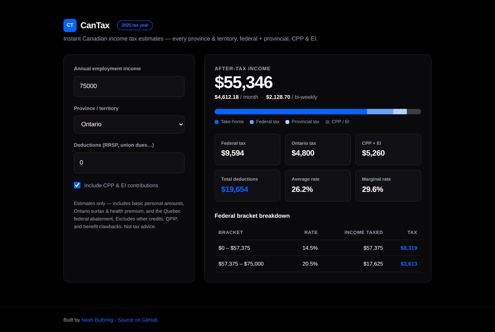

# CanTax — Canadian Income Tax Calculator

Instant income tax estimates for **all 13 Canadian provinces and territories** (2025 tax year). Enter an income, pick a province, and see federal tax, provincial tax, CPP/CPP2/EI, average and marginal rates, and a live bracket-by-bracket breakdown — all recalculated as you type.

**[Live demo →](https://noahbulbring.github.io/cantax/)**



## Features

- **Every jurisdiction** — federal brackets plus all 10 provinces and 3 territories, including Ontario's surtax and health premium and the Quebec federal abatement
- **Payroll contributions** — CPP, the CPP2 second earnings ceiling, and EI (Quebec rates handled separately)
- **Basic personal amounts** — including the federal BPA phase-out for high earners
- **Deduction savings** — shows the estimated federal and provincial income tax saved by deductions
- **Visual take-home split** — a stacked bar showing take-home vs federal / provincial / payroll
- **Bracket breakdown table** — exactly how much income lands in each federal bracket
- **Zero dependencies** — plain HTML/CSS/JS, runs entirely in the browser, nothing leaves your machine

## Run locally

No build step:

```bash
git clone https://github.com/NoahBulbring/cantax.git
cd cantax
open index.html   # or just double-click it
```

## How it works

`tax-data.js` holds the 2025 rate tables (CRA indexed amounts and provincial budgets). `app.js` runs a standard progressive-bracket calculation, applies non-refundable basic-personal-amount credits at the lowest bracket rate, then layers on jurisdiction-specific rules (Ontario surtax → health premium, Quebec 16.5% abatement) and payroll contributions.

> **Note:** the federal first-bracket rate is shown as 14.5% for 2025 — the legislated mid-year rate cut (15% Jan–Jun, 14% Jul–Dec) averages to 14.5% for the full tax year.

## Disclaimer

Estimates only. Excludes credits beyond the basic personal amounts (no employment amount, tuition, medical, etc.), QPIP, and benefit clawbacks. Not tax, accounting, or legal advice.

## Build prompt

This project was built end-to-end by an AI agent from this prompt:

> Build a polished Canadian income tax calculator for the current tax year: federal + all provinces/territories, CPP/EI, marginal vs average rate, live bracket breakdown visual. Static site, zero dependencies.

## License

MIT © Noah Bulbring
